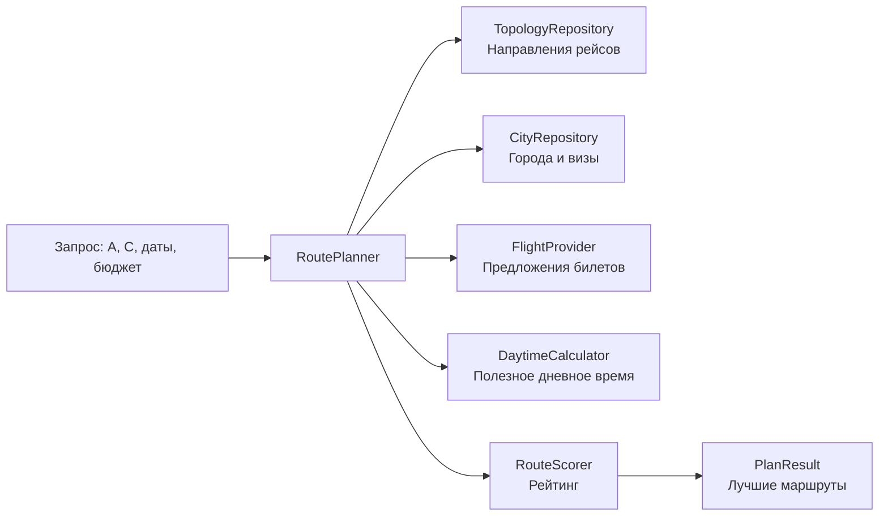

# Устройство и алгоритмы UBAS

## Назначение

UBAS подбирает путешествия вида `A → B → C`, где B — туристическая остановка
длиной до трёх дней. Сервис не покупает билеты и не бронирует отели: он находит
предложения, учитывает визу и риски пересадки и ранжирует варианты.

## Компоненты

Ядро находится в `src/ubas_backend/routing`. Оно не зависит от HTTP, конкретного
агрегатора или СУБД: вместо них используются протоколы из `ports.py`. Сейчас
`SqliteCatalog` реализует топологию и профили городов, `WeightedScorer` — рейтинг,
а `LocalDaytimeCalculator` — расчёт местного дневного времени.

`FlightProvider` остаётся адаптером: будущая интеграция приводит ответ агрегатора
к моделям `FlightQuery` и `FlightSearchResult`, не меняя алгоритм поиска.

## Данные

`RouteRequest` содержит города отправления и назначения, период, гражданство,
количество пассажиров, валюту, бюджет, исключённые города и требование багажа.
Даты включительны: маршрут должен вылететь из A и прибыть в C в указанный период.

`TicketOffer` описывает одну самостоятельную покупку. В нём есть сегменты,
конечная цена всех пассажиров, срок действия котировки, багаж и защищённость
стыковки. Единый билет содержит два сегмента `A → B → C`; самостоятельная
пересадка складывается из `A → B` и `B → C` и помечается как рискованная.

Профиль B содержит туристическую оценку, минимальную и рекомендуемую длительность
визита, часовую зону, справочную цену отеля и правила въезда для гражданства.
Виза должна разрешать выход в город; неизвестные, устаревшие или неподходящие
правила не пропускают город в выдачу.

## Поток подбора

1. По топологии находятся города B: пересечение рейсов из A и рейсов в C.
2. Исключаются A, C, запрещённые пользователем города, города с низкой туристической
   оценкой и без подходящей визы.
3. Для каждого B параллельно запрашиваются отдельные `A → B`, `B → C` и единые
   `A → B → C` предложения. Число одновременных вызовов и тайм-аут ограничены.
4. Предложения валидируются по направлению, датам, пассажирам, валюте, сроку
   действия и багажу.
5. Единые билеты становятся кандидатом сразу. Для отдельных билетов строятся пары
   с остановкой между `min_stopover_hours` и `max_stopover_hours`.
6. Проверяются длительность, визовый срок, смена аэропорта, бюджет и полезное
   дневное время. Оставшиеся кандидаты получают рейтинг.
7. Дубликаты убираются, число вариантов на город ограничивается, затем возвращается
   top-N.

Если источник билетов не ответил, профиль города отсутствует или достигнут лимит,
`PlanResult.complete` будет `false`, а `warnings` пояснит причину. `rejected`
показывает счётчики отсева по правилам.

## Алгоритмы

### Сочетание отдельных билетов

Рейсы `B → C` сортируются по вылету. Для каждого прилёта `A → B` бинарный поиск
находит границы окна:

`arrival + min_stopover_hours ≤ departure ≤ arrival + max_stopover_hours`.

Поиск границ занимает `O(log m)`, где m — число рейсов из B, и позволяет не
сравнивать все пары. Дальше оцениваются только варианты внутри допустимого окна.

### Полезное время

Из времени остановки вычитаются буферы после прилёта и перед вылетом, а также
дополнительный запас для самостоятельной стыковки и смены аэропорта. Остаток
переводится в часовую зону B. По умолчанию «день» — 08:00–22:00 по местному времени.
Кандидат проходит, если дневное время превышает минимальный порог для города и
составляет больше половины доступного времени. Все интервалы считаются в UTC,
поэтому корректно работают разные часовые пояса и летнее время.

### Виза, стоимость и риск

Проверяются доступность и актуальность визы, срок её оформления и допустимая
длительность пребывания. Итоговая цена:

`цена всех билетов + цена визы × число пассажиров`.

Отели и наземный транспорт не входят в цену MVP. Предупреждения в результате
отдельно сообщают о незащищённой стыковке, смене аэропорта и багаже.

### Рейтинг

Каждый фактор нормализуется в диапазон 0–1. Формула:

`score = 100 × Σ(вес × utility) / Σ(вес)`.

| Фактор | Вес по умолчанию |
| --- | ---: |
| Цена с визой | 0.40 |
| Туристическая ценность | 0.25 |
| Дневное время | 0.15 |
| Удобство визы | 0.10 |
| Длительность пути | 0.05 |
| Защита стыковки | 0.05 |

Все веса, буферы, лимиты и пороги задаются в `PlannerConfig`. В ответе возвращаются
вклады факторов, поэтому интерфейс может объяснить пользователю рейтинг варианта.
Это эвристика: она не гарантирует самую низкую цену на всём рынке.

## Расширение

Без переписывания ядра можно добавить HTTP API, реального провайдера билетов,
PostgreSQL для каталога, конвертацию валют, погоду и сезонность, персональные
предпочтения, несколько остановок и оценку риска отмены рейса.
