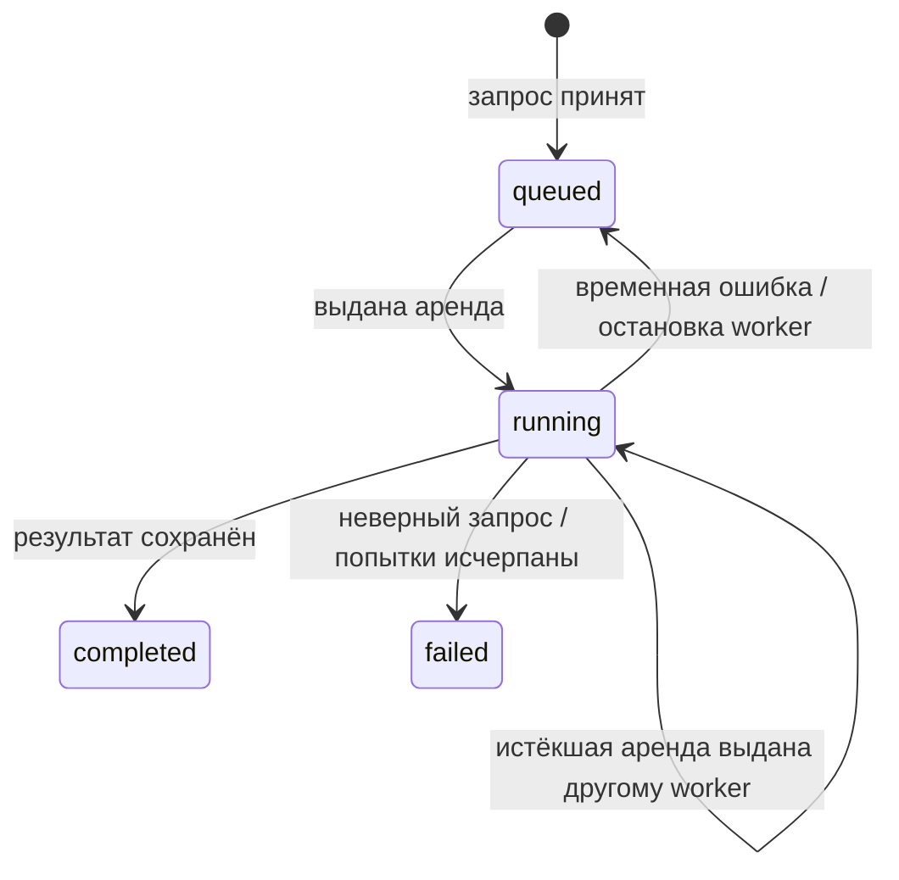

# Запросы маршрутов и очередь

`QueryManager` проверяет запрос и сохраняет его через `QueryRepository`.
API не запускает поиск билетов: этим занимается отдельный `QueryWorker`.
Состояние и результаты хранятся в PostgreSQL, каталог маршрутов — в SQLite.

## Слои

| Модуль | Ответственность |
| --- | --- |
| `api/router.py` | HTTP-контракт, статусы и валидация заголовков |
| `query_manager/service.py` | Прикладные операции и проверка политики поиска |
| `query_manager/ports.py` | Протокол хранилища и неизменяемая выданная аренда |
| `query_manager/models.py` | Типизированные SQLAlchemy ORM-модели |
| `query_manager/repository.py` | Короткие транзакции, дедупликация, выдача и завершение задач |
| `query_manager/worker.py` | Рабочие слоты, продление аренды, отмена, повторы |
| `database.py` | Async engine и фабрика сессий |
| `runtime.py` | Сборка зависимостей и закрытие ресурсов |
| `migrations/` внутри Python-пакета | Alembic-ревизии, включаемые в wheel |

Вместо текстовых SQL-запросов используются ORM и выражения SQLAlchemy Core.
У каждой операции отдельная сессия; HTTP-запрос, рабочий слот и heartbeat
не разделяют изменяемую `AsyncSession`. Расчёт выполняется вне транзакции БД.

## Состояния



`route_queries` хранит тело запроса, его отпечаток, состояние, число и лимит
попыток, аренду, результат и безопасное описание ошибки.
Лимит попыток фиксируется при создании задачи и одинаков для всех её обработчиков.
Остановка worker потребляет текущую попытку; последняя попытка не возвращается
в бесконечный цикл перезапусков.

## Идемпотентность и дедупликация

`Idempotency-Key` необязателен, но рекомендуется для сетевых повторов фронта.
Его длина — от 1 до 255 символов.

1. Ключ резервируется в `query_idempotency_keys` и блокируется до конца транзакции.
2. Проверяется соответствие отпечатка тела. Чужое тело с тем же ключом даёт 409.
3. Ищется и блокируется существующий активный запрос с таким отпечатком.
4. При отсутствии активной задачи выполняется вставка с обработкой конфликта.
   Если конкурирующая задача успела завершиться, операция поиска/вставки повторяется.
5. Ключ привязывается к найденной или созданной задаче в той же транзакции.

Каждый ключ сохраняется, даже если несколько ключей ссылаются на одну задачу.
Повтор такого ключа после завершения поиска возвращает прежний UUID и результат.
Новый ключ или запрос без ключа после завершения создаёт новый поиск.
Активные дубликаты запрещены частичным уникальным индексом в PostgreSQL.

## Аренда и устойчивость

Захват использует `with_for_update(skip_locked=True)` в короткой транзакции.
Два worker не получают одну действующую аренду. Каждый захват увеличивает
попытку и создаёт новый UUID-токен.

Все сроки аренды считаются по часам PostgreSQL. Продление и запись результата
проверяют состояние, токен и то, что аренда ещё не истекла.
Heartbeat работает каждые `lease_seconds / 3`. Потеря аренды, ошибка или таймаут
heartbeat отменяют расчёт и его дочерние запросы. Старый владелец не может
записать результат поверх нового.

Ошибка БД при захвате/сохранении не убивает слот: ошибка журналируется, затем
слот повторяет работу с растущей задержкой до 30 секунд. Задача после аварии
восстанавливается через истечение аренды.

Для временных ошибок расчёта применяется экспоненциальная задержка
`retry_seconds × 2^(attempt − 1)`, показатель ограничен 6.
Неверные запросы завершаются без повторов.
Время одного расчёта ограничено `UBAS_WORKER_TIMEOUT_SECONDS`.
Отмена при завершении процесса сначала останавливает расчёт, затем пытается
вернуть задачу в очередь; при недоступной БД восстановление произойдёт по аренде.

Гарантия выполнения — at-least-once: при сбое между внешним вызовом и фиксацией
результата вызов может повториться. Поставщик билетов должен корректно обрабатывать
отмену coroutine; синхронный блокирующий I/O внутри его `search` недопустим.

## HTTP

Тело POST и структура успешных ответов сохранены.

| Ручка | Ответ |
| --- | --- |
| `POST /api/v1/queries` | 202: `query_id`, `status`, `reused`; заголовок `Location` |
| `GET /api/v1/queries/{id}` | 200: статус, попытка, даты, `result_available`, `failure` |
| `GET /api/v1/queries/{id}/result` | 200: `{query_id, result: PlanResult}` |

Дополнительные ответы:

- POST: 409 при конфликте ключа; 422 при неверных параметрах, пустом ключе,
  слишком длинном диапазоне дат или валюте без настроенного масштаба рейтинга.
- GET: 404 для неизвестного UUID.
- GET результата: 202 и `Retry-After: 2`, пока расчёт идёт; 409 при `failed`.
- `complete=false` в `PlanResult` означает частичный поиск и не является ошибкой очереди.

## Конфигурация и запуск

Переменные перечислены в `.env.example`. API требует PostgreSQL.
Worker дополнительно требует существующий SQLite-каталог и фабрику поставщика:
`UBAS_FLIGHT_PROVIDER_FACTORY=package.module:factory`.
Фабрика без аргументов возвращает объект с `async search(FlightQuery)`.
Если он предоставляет `async aclose()`, runtime вызовет его при завершении.

`UBAS_PLANNER_CONFIG_PATH` указывает на JSON `PlannerConfig`, общий для API и
worker. По умолчанию разрешена RUB с масштабом 60000. Для другой валюты задайте
соответствующее значение в `price_references` и обеспечьте данные в этой валюте.

```shell
uv sync --locked
uv run --env-file .env ubas-migrate
uv run --env-file .env ubas-api
uv run --env-file .env ubas-worker
```

API и worker запускаются в отдельных терминалах. Для локального режима
`UBAS_EMBEDDED_WORKER=true` включает worker в процессе API.

## Обновление существующей БД

Остановите старые API и worker перед миграцией: новая схема переносит ключи
в отдельную таблицу и удаляет прежний столбец `idempotency_key`.
`ubas-migrate` распознаёт исходную запись `0001_route_queries.sql` в
`schema_migrations`, отмечает базовую Alembic-ревизию и переносит ключи.
UUID, запросы и результаты сохраняются. Неизвестная неверсионированная схема
не принимается автоматически.

Миграции используют транзакционную advisory-блокировку PostgreSQL, поэтому
два запуска `ubas-migrate` не применяют одну ревизию одновременно.
Миграции поставляются в пакете и работают после установки wheel.
Автоматический downgrade второй ревизии запрещён: старая схема не может
представить несколько клиентских ключей для одной задачи.

## Проверки

```shell
uv run --locked python -m unittest discover -s tests -v
```

Без `UBAS_TEST_DATABASE_URL` выполняются проверки API, отмены, восстановления
слотов и алгоритма. Для конкурентных проверок задайте URL отдельной PostgreSQL-БД
с именем `ubas_test_*`; её очередь очищается перед каждым сценарием.
CI выполняет Ruff, форматирование и mypy; тестовый шаг не добавлен.
