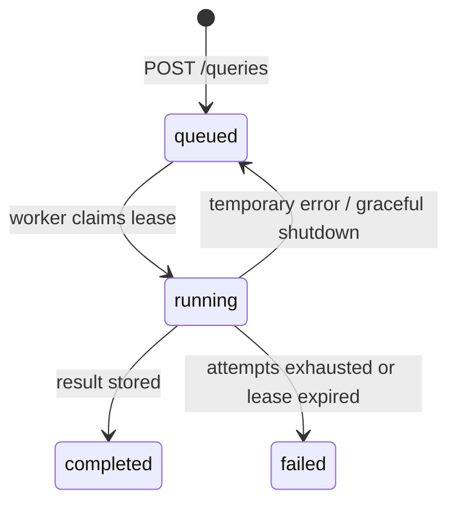

# Очередь запросов маршрутов

`QueryManager` связывает FastAPI и `RoutePlanner`. HTTP-запрос не вычисляет
маршрут: он атомарно создаёт запись в PostgreSQL, а worker позже берёт её в работу.
Это защищает API от долгих ответов и позволяет безопасно запускать несколько
экземпляров приложения и worker'ов.

## Состояния



В `route_queries` сохраняются неизменяемое тело `RouteRequest`, отпечаток тела,
статус, число попыток, lease-токен, итоговый `PlanResult` или безопасная ошибка.
Миграция находится в `migrations/0001_route_queries.sql`.

## Атомарность и дедупликация

Для `POST /api/v1/queries` клиент должен передавать заголовок `Idempotency-Key`.
В одной PostgreSQL-транзакции сервис проверяет ключ и вставляет задачу.

- Повтор с тем же ключом и тем же телом возвращает тот же `query_id`.
- Повтор с тем же ключом и иным телом возвращает `409 Conflict`.
- Для активных одинаковых запросов действует частичный уникальный индекс по SHA-256
  нормализованного тела. Поэтому параллельные одинаковые запросы без ключа всё
  равно используют одну работу.
- Завершённые задачи не участвуют в дедупликации по телу: цены и расписание могут
  успеть измениться. Идемпотентный ключ по-прежнему возвращает исходный результат.

Worker выбирает задачу через `FOR UPDATE SKIP LOCKED`, ставит статус `running` и
записывает уникальный lease-токен. Итог записывается только при совпадении токена.
Поздний worker не может перезаписать результат нового владельца задачи.
Lease продлевается во время расчёта; после падения процесса задача будет взята
повторно. Внешний билетный сервис может быть вызван повторно только после аварии
между его вызовом и фиксацией результата — это типичная at-least-once семантика.

## HTTP API

| Ручка | Ответ |
| --- | --- |
| `POST /api/v1/queries` | `202`, UUID, статус и `reused`; добавляет `Location` |
| `GET /api/v1/queries/{id}` | Текущий статус, попытка, даты, доступность результата и безопасная ошибка |
| `GET /api/v1/queries/{id}/result` | `200` с `PlanResult`, `202` пока идёт расчёт, `409` при ошибке, `404` для неизвестного UUID |

Результат хранит маршруты, рейтинг, предупреждения и флаг полноты поиска из
`RoutePlanner`. Частичный результат (`complete=false`) — это успешный расчёт,
а не ошибка очереди.

## Запуск

1. Создайте PostgreSQL-базу и заполните переменные по `.env.example`.
2. Примените схему очереди:

   ```shell
   uv run ubas-migrate
   ```

3. Подготовьте SQLite-каталог топологии и городов. Он не создаётся автоматически:
   worker только читает проверенные данные.
4. Реализуйте и подключите фабрику `FlightProvider` через
   `UBAS_FLIGHT_PROVIDER_FACTORY=package.module:factory`. Фабрика без аргументов
   должна вернуть объект с асинхронным методом `search(FlightQuery)`.
5. Запустите API и отдельный worker:

   ```shell
   uv run ubas-api
   uv run ubas-worker
   ```

Для локальной разработки worker можно запустить внутри API, установив
`UBAS_EMBEDDED_WORKER=true`; при этом всё равно нужны каталог и провайдер.
В production API и worker следует запускать раздельно.
