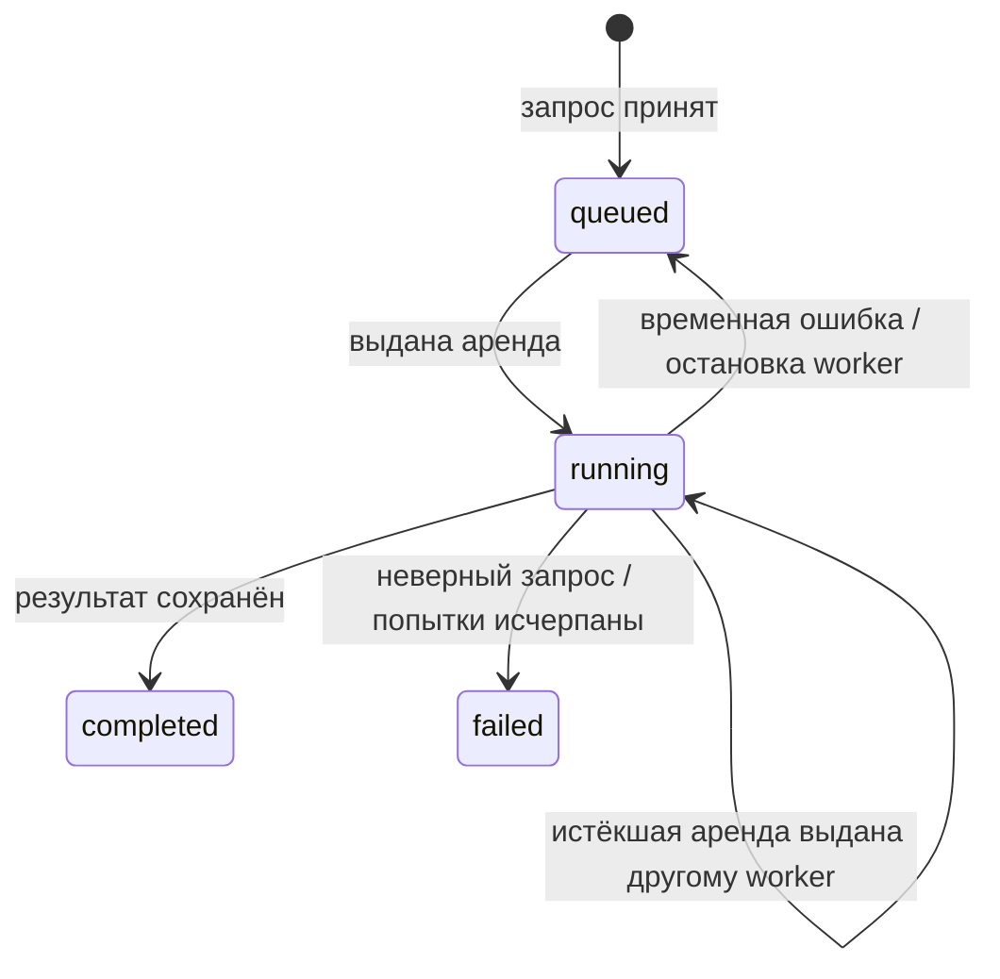

# Запросы маршрутов и очередь

`QueryManager` проверяет запрос и сохраняет его через `QueryRepository`.
API не запускает поиск билетов: этим занимается отдельный `QueryWorker`.
Состояние и результаты хранятся в PostgreSQL, каталог маршрутов — в SQLite.

## Слои

| Модуль | Ответственность |
| --- | --- |
| `api/router.py` | HTTP-контракт, статусы и валидация заголовков |
| `query_manager/service.py` | Прикладные операции и проверка политики поиска |
| `query_manager/ports.py` | Протокол хранилища и неизменяемая выданная аренда |
| `query_manager/models.py` | Типизированные SQLAlchemy ORM-модели |
| `query_manager/repository.py` | Короткие транзакции, дедупликация, выдача и завершение задач |
| `query_manager/worker.py` | Рабочие слоты, продление аренды, отмена, повторы |
| `database.py` | Async engine и фабрика сессий |
| `runtime.py` | Сборка зависимостей и закрытие ресурсов |
| `migrations/` внутри Python-пакета | Alembic-ревизии, включаемые в wheel |

Вместо текстовых SQL-запросов используются ORM и выражения SQLAlchemy Core.
У каждой операции отдельная сессия; HTTP-запрос, рабочий слот и heartbeat
не разделяют изменяемую `AsyncSession`. Расчёт выполняется вне транзакции БД.

## Состояния



`route_queries` хранит тело запроса, его отпечаток, состояние, число и лимит
попыток, аренду, результат и безопасное описание ошибки.
Лимит попыток фиксируется при создании задачи и одинаков для всех её обработчиков.
Остановка worker потребляет текущую попытку; последняя попытка не возвращается
в бесконечный цикл перезапусков.

## Идемпотентность и дедупликация

`Idempotency-Key` необязателен, но рекомендуется для сетевых повторов фронта.
Его длина — от 1 до 255 символов.

1. Ключ резервируется в `query_idempotency_keys` и блокируется до конца транзакции.
2. Проверяется соответствие отпечатка тела. Чужое тело с тем же ключом даёт 409.
3. Ищется и блокируется существующий активный запрос с таким отпечатком.
4. При отсутствии активной задачи выполняется вставка с обработкой конфликта.
   Если конкурирующая задача успела завершиться, операция поиска/вставки повторяется.
5. Ключ привязывается к найденной или созданной задаче в той же транзакции.

Каждый ключ сохраняется, даже если несколько ключей ссылаются на одну задачу.
Повтор такого ключа после завершения поиска возвращает прежний UUID и результат.
Новый ключ или запрос без ключа после завершения создаёт новый поиск.
Активные дубликаты запрещены частичным уникальным индексом в PostgreSQL.

## Аренда и устойчивость

Захват использует `with_for_update(skip_locked=True)` в короткой транзакции.
Два worker не получают одну действующую аренду. Каждый захват увеличивает
попытку и создаёт новый UUID-токен.

Все сроки аренды считаются по часам PostgreSQL. Продление и запись результата
проверяют состояние, токен и то, что аренда ещё не истекла.
Heartbeat работает каждые `lease_seconds / 3`. Потеря аренды, ошибка или таймаут
heartbeat отменяют расчёт и его дочерние запросы. Старый владелец не может
записать результат поверх нового.

Ошибка БД при захвате/сохранении не убивает слот: ошибка журналируется, затем
слот повторяет работу с растущей задержкой до 30 секунд. Задача после аварии
восстанавливается через истечение аренды.

Для временных ошибок расчёта применяется экспоненциальная задержка
`retry_seconds × 2^(attempt − 1)`, показатель ограничен 6.
Неверные запросы завершаются без повторов.
Время одного расчёта ограничено `UBAS_WORKER_TIMEOUT_SECONDS`.
Отмена при завершении процесса сначала останавливает расчёт, затем пытается
вернуть задачу в очередь; при недоступной БД восстановление произойдёт по аренде.

Гарантия выполнения — at-least-once: при сбое между внешним вызовом и фиксацией
результата вызов может повториться. Поставщик билетов должен корректно обрабатывать
отмену coroutine; синхронный блокирующий I/O внутри его `search` недопустим.

## HTTP

Тело POST и структура успешных ответов сохранены.

| Ручка | Ответ |
| --- | --- |
| `POST /api/v1/queries` | 202: `query_id`, `status`, `reused`; заголовок `Location` |
| `GET /api/v1/queries/{id}` | 200: статус, попытка, даты, `result_available`, `failure` |
| `GET /api/v1/queries/{id}/result` | 200: `{query_id, result: PlanResult}` |

Дополнительные ответы:

- POST: 409 при конфликте ключа; 422 при неверных параметрах, пустом ключе,
  слишком длинном диапазоне дат или валюте без настроенного масштаба рейтинга.
- GET: 404 для неизвестного UUID.
- GET результата: 202 и `Retry-After: 2`, пока расчёт идёт; 409 при `failed`.
- `complete=false` в `PlanResult` означает частичный поиск и не является ошибкой очереди.

### CORS для фронтенда

`CORSMiddleware` обрабатывает preflight `OPTIONS` с `Origin` и
`Access-Control-Request-Method`. По умолчанию разрешены origin
`http://localhost:5173` и `http://127.0.0.1:5173`. Это разные origin, как и
разные порты одного хоста. Адрес API для локального фронтенда —
`http://localhost:8000/api/v1/queries`.

Разрешены методы `GET`, `POST`, заголовки запроса `Content-Type` и
`Idempotency-Key`. Заголовки ответа `Location` и `Retry-After` доступны
браузерному JavaScript. Credentials/cookies через CORS не разрешены.
Неизвестные origin не получают `Access-Control-Allow-Origin`;
preflight для неподдерживаемых origin, методов или заголовков возвращает 400.
Браузер добавляет `Origin` самостоятельно: фронтенду не нужно вручную отправлять
`OPTIONS` или ответные заголовки `Access-Control-Allow-*`.

`UBAS_CORS_ORIGINS` заменяет список origin: значения разделяются запятыми,
окружающие пробелы и завершающий `/` удаляются. Пустое значение отключает
межсайтовый доступ. Настройка читается при создании приложения;
Compose передаёт её в API, изменение требует пересоздания контейнера.
Подробности механизма — в [документации FastAPI](https://fastapi.tiangolo.com/tutorial/cors/).

## Конфигурация и запуск

Переменные перечислены в `.env.example`. API требует PostgreSQL.
Worker дополнительно требует существующий SQLite-каталог и фабрику поставщика:
`UBAS_FLIGHT_PROVIDER_FACTORY=package.module:factory`.
Фабрика без аргументов возвращает объект с `async search(FlightQuery)`.
Если он предоставляет `async aclose()`, runtime вызовет его при завершении.

`UBAS_PLANNER_CONFIG_PATH` указывает на JSON `PlannerConfig`, общий для API и
worker. По умолчанию разрешена RUB с масштабом 60000. Для другой валюты задайте
соответствующее значение в `price_references` и обеспечьте данные в этой валюте.

```shell
uv sync --locked
uv run --env-file .env ubas-migrate
uv run --env-file .env ubas-api
uv run --env-file .env ubas-worker
```

API и worker запускаются в отдельных терминалах. Для локального режима
`UBAS_EMBEDDED_WORKER=true` включает worker в процессе API.

## Docker Compose

В `compose.yaml` по умолчанию включены `postgres` и `api`; профиль `worker`
добавляет отдельный процесс обработки задач из того же образа.
Явное имя проекта `ubas-backend` изолирует контейнеры, сеть и volume от других
проектов в каталогах с именем `backend`. Флаг `-p` и переменная
`COMPOSE_PROJECT_NAME` переопределяют это имя: не задавайте имя другого проекта.

Образ приложения строится на Python 3.14 через `uv sync --locked --no-dev`.
В финальный образ переносится установленный пакет с Alembic-ревизиями,
без исходного checkout, локального `.env` и SQLite-файлов. Приложение работает
от пользователя `ubas` с UID 10001. Каталог `./var` монтируется для чтения:
его файлы должны быть доступны этому пользователю.

### PostgreSQL и подключение

Используется официальный образ PostgreSQL 18. Расширения для схемы очереди
не требуются: используются JSONB, UUID, блокировки строк, частичные уникальные
индексы и advisory-блокировка миграций. API и каждый worker имеют собственный
пул максимум на 10 соединений; учитывайте это при увеличении числа процессов.

При первом запуске на пустом volume образ PostgreSQL создаёт базу и пользователя.
Пользователь из `POSTGRES_USER` создаётся с правами superuser; эта конфигурация
предназначена для самостоятельного локального запуска проекта.

| Переменная Compose | Назначение | По умолчанию |
| --- | --- | --- |
| `POSTGRES_DB` | Имя создаваемой базы | `ubas` |
| `POSTGRES_USER` | Пользователь базы | `ubas` |
| `POSTGRES_PASSWORD` | Пароль пользователя | Обязателен, без значения по умолчанию |
| `UBAS_HTTP_PORT` | Порт API на хосте | `8000` |

Compose автоматически читает `.env` для подстановок, но не передаёт все его
переменные в контейнеры. Приложение получает выбранные настройки из `compose.yaml`.
Внутренний URL строится entrypoint через `SQLAlchemy.URL.create` из `POSTGRES_*`,
поэтому специальные символы пароля не требуют ручного URL-кодирования.
`UBAS_DATABASE_URL` из локального `.env` не используется сервисами Compose:
внутри сети адрес БД — `postgres:5432`, а не `127.0.0.1`.

PostgreSQL доступен только в сети Compose. Для административного подключения:

```shell
docker compose exec postgres sh -c 'exec psql -U "$POSTGRES_USER" -d "$POSTGRES_DB"'
```

Данные сохраняются в volume `ubas-backend_postgres_data` (ключ `postgres_data`
в Compose), смонтированном в
`/var/lib/postgresql`, как требуется образу PostgreSQL 18. Обычный `down`
сохраняет volume. Переменные `POSTGRES_*` инициализируют только пустое хранилище:
изменение пароля в `.env` не меняет пароль существующего пользователя БД.
Смена major-версии образа требует отдельного обновления данных PostgreSQL.

Если предыдущий запуск без явного имени проекта создал контейнеры
`backend-api-1` / `backend-postgres-1`, остановите только эти контейнеры.
Не используйте `--remove-orphans` или `down --volumes` для старого проекта
`backend`: его контейнеры и volume могут принадлежать другому приложению.
Новый проект создаст отдельную базу без переноса старых данных.

### Порядок запуска

1. `postgres` проходит TCP-проверку `pg_isready`.
2. `api` выполняет `ubas-migrate` из установленного пакета.
3. Только после успешной миграции запускается Uvicorn на `0.0.0.0:8000`.
4. Проверка `/openapi.json` подтверждает запуск HTTP-приложения.
5. Если включён профиль `worker`, worker стартует после готовности API и БД.

Миграция выполняется при каждом старте API; уже применённые ревизии пропускаются.
Ошибка миграции не позволяет запустить HTTP-сервер. При обновлении остановите
старые процессы через `docker compose --profile worker down` без удаления volume,
а затем запускайте новую сборку. Автоматическое применение миграций при старте
относится к контейнерному entrypoint; локальные `ubas-api` / `ubas-worker`
по-прежнему требуют отдельного запуска `ubas-migrate`.

### Worker и каталог

Для `docker compose --profile worker up --build -d` подготовьте:

- `./var/catalog.sqlite3` с таблицами `city_profiles` и `flight_links`;
- `UBAS_CATALOG_PATH=./var/catalog.sqlite3` — путь внутри контейнера;
- `UBAS_FLIGHT_PROVIDER_FACTORY` с фабрикой провайдера, модуль которой
  включён в установленный пакет или зависимости образа.

Каталог не создаётся и не наполняется автоматически. Шаблон фабрики из
`.env.example` не является работающей интеграцией. API без worker доступен,
но задачи остаются в очереди. `UBAS_EMBEDDED_WORKER` в Compose принудительно
выключен: обработка выполняется отдельным сервисом.

Для проверки всего цикла с демонстрационным каталогом доступна фабрика
`ubas_backend.routing.demo:create_flight_provider`. Задайте её в
`UBAS_FLIGHT_PROVIDER_FACTORY` и добавьте `COMPOSE_PROFILES=worker` в `.env`,
чтобы обычный `docker compose up --build -d` включал worker. Это явное включение
демо с вымышленными билетами, а не подключение к реальному билетному сервису.
Границы набора данных описаны в [routing.md](routing.md#запуск-примера).
Worker использует существующий SQLite-файл и обрабатывает также ранее
поставленные в очередь запросы. Каталог не переписывается при выборе фабрики.

Если нужен общий `PlannerConfig`, разместите JSON в `./var/planner.json`
и задайте `UBAS_PLANNER_CONFIG_PATH=./var/planner.json`. Значение передаётся
API и worker; при отсутствии переменной используется стандартная конфигурация.
Файлы за пределами `./var` нужно монтировать отдельно через override Compose.
Дополнительные настройки и секреты адаптера также передавайте явно через override,
не добавляя их в Dockerfile.

Для запуска образа вне Compose можно передать обычный `UBAS_DATABASE_URL`:
entrypoint сохранит его. Флаг `--migrate` перед командой включает миграцию;
команда образа по умолчанию — `--migrate uvicorn ubas_backend.main:app
--host 0.0.0.0 --port 8000`. При переопределении команды на `ubas-worker`
миграцию следует выполнить отдельно.

Порядок ожидания готовности соответствует
[документации Docker Compose](https://docs.docker.com/compose/how-tos/startup-order/),
изоляция ресурсов — [описанию имени проекта](https://docs.docker.com/compose/how-tos/project-name/),
а путь volume — [документации образа PostgreSQL](https://hub.docker.com/_/postgres).
Сборка окружения основана на [рекомендациях uv для Docker](https://docs.astral.sh/uv/guides/integration/docker/).
Включение профиля через `COMPOSE_PROFILES` описано в
[документации Docker Compose](https://docs.docker.com/compose/how-tos/profiles/).

## Обновление существующей БД

Остановите старые API и worker перед миграцией: новая схема переносит ключи
в отдельную таблицу и удаляет прежний столбец `idempotency_key`.
`ubas-migrate` распознаёт исходную запись `0001_route_queries.sql` в
`schema_migrations`, отмечает базовую Alembic-ревизию и переносит ключи.
UUID, запросы и результаты сохраняются. Неизвестная неверсионированная схема
не принимается автоматически.

Миграции используют транзакционную advisory-блокировку PostgreSQL, поэтому
два запуска `ubas-migrate` не применяют одну ревизию одновременно.
Миграции поставляются в пакете и работают после установки wheel.
Автоматический downgrade второй ревизии запрещён: старая схема не может
представить несколько клиентских ключей для одной задачи.

## Проверки

```shell
uv run --locked python -m unittest discover -s tests -v
```

Без `UBAS_TEST_DATABASE_URL` выполняются проверки API, отмены, восстановления
слотов и алгоритма. Для конкурентных проверок задайте URL отдельной PostgreSQL-БД
с именем `ubas_test_*`; её очередь очищается перед каждым сценарием.
CI выполняет Ruff, форматирование и mypy; тестовый шаг не добавлен.
